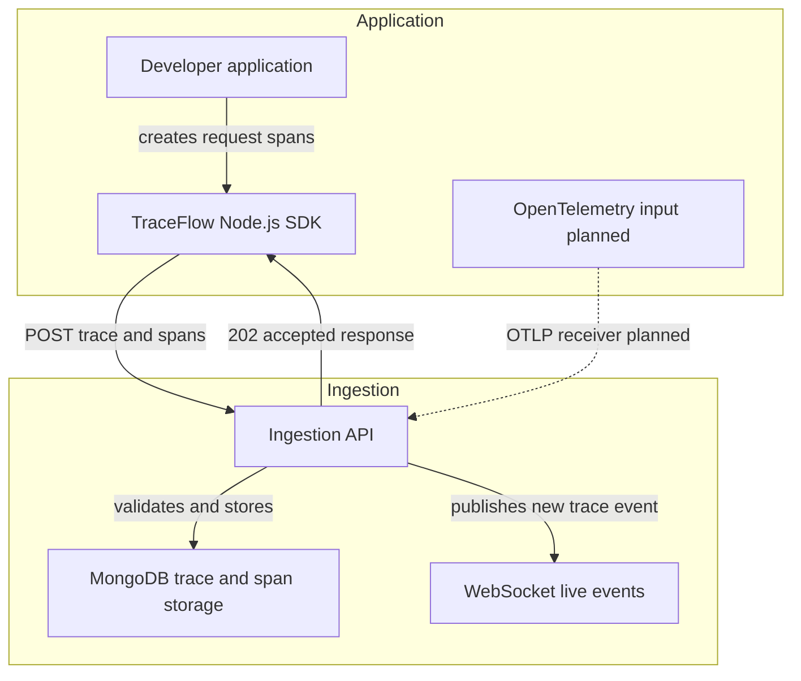
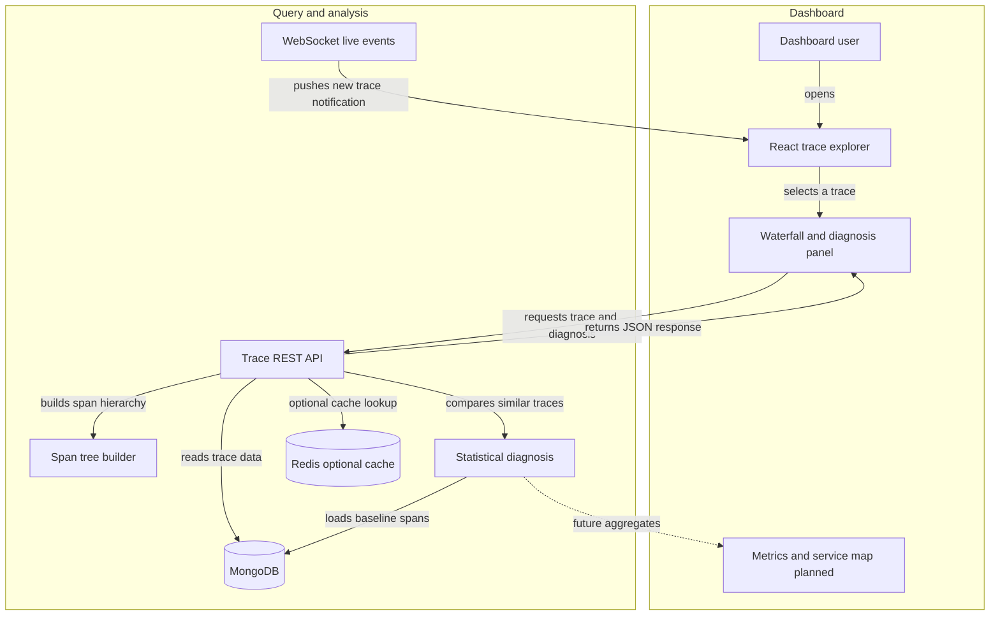
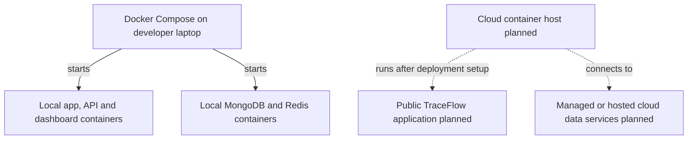
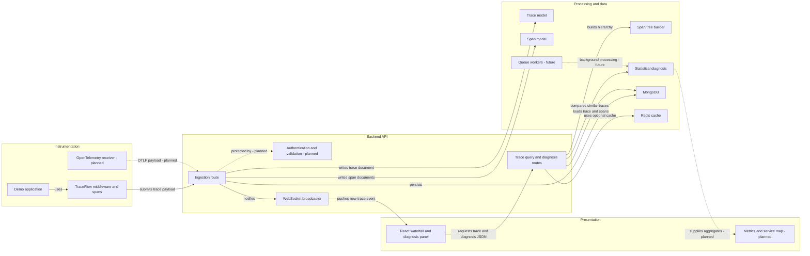

# Architecture Diagram

This document describes TraceFlow's target architecture for the full project. Components labeled planned or future are roadmap items, not claims about the current implementation. The same diagrams are included in the repository README.

## Application Architecture

### Telemetry ingestion and storage

<!-- mermaid-checked: no \n, no em-dash/en-dash, no {} in labels, subgraphs are id["label"], arrows are -->|"label"|, all subgraphs closed by end, ids unique -->

### Trace exploration and diagnosis

<!-- mermaid-checked: no \n, no em-dash/en-dash, no {} in labels, subgraphs are id["label"], arrows are -->|"label"|, all subgraphs closed by end, ids unique -->

### Local and future deployment

<!-- mermaid-checked: no \n, no em-dash/en-dash, no {} in labels, subgraphs are id["label"], arrows are -->|"label"|, all subgraphs closed by end, ids unique -->

### Technology Stack Summary

| Layer | Technology | Version | Purpose |
|---|---|---|---|
| Demo application and ingestion | Node.js, Express | See package manifests | Demo workload and HTTP APIs |
| Instrumentation | TraceFlow middleware and manual spans | Project code | Capture request and operation timing |
| Dashboard | React, Vite | See package manifest | Trace explorer and waterfall UI |
| Trace storage | MongoDB, Mongoose | MongoDB 7 in Compose | Persist traces and spans |
| Cache | Redis | Redis 7 in Compose | Optional trace response cache |
| Live updates | WebSocket using `ws` | See package manifest | Notify dashboard of new traces |
| Local orchestration | Docker Compose | Compose specification | Start local services together |
| Queue, workers and OTLP | Not selected | Planned | Future ingestion and scaling integrations |

### Data Storage & External Services

MongoDB stores trace and span records. Redis is an optional cache; stored trace queries should continue to work when Redis is unavailable. The local Compose setup runs these services on the developer's computer. It does not deploy or host TraceFlow in the cloud. A queue, OpenTelemetry receiver, and cloud hosting belong to later project stages.

### Key Architectural Decisions

- Start as a modular application with direct ingestion and MongoDB; add a queue only when a measured reliability or throughput need justifies the added complexity.
- Use matching routes and span structures to compare traces; report statistical evidence as a diagnostic lead, not proof of the root cause.
- Treat Docker Compose as local orchestration. Cloud hosting, production secrets, HTTPS, and durable cloud storage require separate deployment configuration.

## Component Relationships

This view shows how the major modules work together. Planned components are labeled as such and are not claims about the current implementation.

<!-- mermaid-checked: no \n, no em-dash/en-dash, no {} in labels, subgraphs are id["label"], arrows are -->|"label"|, all subgraphs closed by end, ids unique -->

### Component Inventory

| Component | Layer | Type | Responsibility |
|---|---|---|---|
| Demo application | Instrumentation | Express app | Generates requests and sample operations |
| TraceFlow middleware and spans | Instrumentation | Middleware/library code | Creates request context and records manual operation spans |
| OpenTelemetry receiver | Instrumentation | Planned integration | Accepts standard OTLP telemetry |
| Ingestion route | Backend API | Express route | Validates and stores incoming trace payloads |
| Trace query and diagnosis routes | Backend API | Express routes | Serves traces, span trees and statistical diagnosis |
| Authentication and validation | Backend API | Planned middleware | Protects ingestion and scopes access |
| WebSocket broadcaster | Backend API | WebSocket service | Publishes new trace events to connected dashboards |
| Span tree builder | Processing | Utility module | Reconstructs parent-child span relationships |
| Statistical diagnosis | Processing | Analysis module | Flags latency outliers and ranks leaf spans using comparable traces |
| Trace and Span models | Data access | Mongoose models | Define persisted trace and span records |
| MongoDB | Data storage | Document database | Persists trace and span records |
| Redis cache | Data storage | Optional cache | Caches trace reads with MongoDB fallback |
| Queue workers | Processing | Future infrastructure | Decouples ingestion from processing if scale requires it |
| React waterfall and diagnosis panel | Presentation | React UI | Displays trace selection, waterfall and diagnosis evidence |
| Metrics and service map | Presentation | Planned UI | Presents aggregate metrics and service dependencies |
