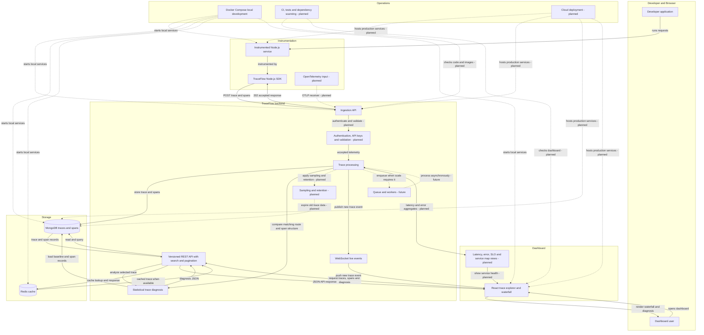
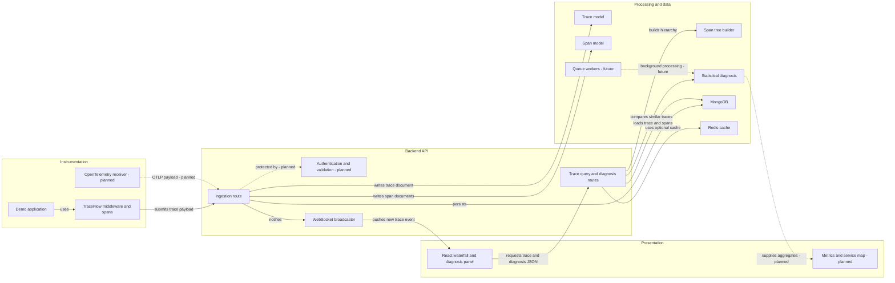

# TraceFlow v1.0

A distributed tracing system for monitoring application performance with real-time waterfall visualization, statistical analysis, and span tree reconstruction.

## Architecture

The diagram below describes the **target architecture** for the full TraceFlow project, including roadmap items that are not implemented yet. It keeps the current Express, React, MongoDB and Redis stack and leaves a queue as a future scaling option rather than a requirement for the first release.

An expanded architecture document with the component inventory is available at [architecture-diagram.md](./.github/modernize/assessment/engines/facts/architecture-diagram.md).

<!-- mermaid-checked: no \n, no em-dash/en-dash, no {} in labels, subgraphs are id["label"], arrows are -->|"label"|, all subgraphs closed by end, ids unique -->


### Request and response flow

1. An application handles a request; the TraceFlow SDK records the request and its spans.
2. The SDK sends trace data to `POST /ingest`. The API validates the payload, stores it, and returns an HTTP response to the SDK.
3. Trace processing builds the span tree and computes the statistical diagnosis from comparable stored traces. This diagnosis is evidence-based and does not require machine learning.
4. The dashboard requests trace details and diagnosis through the REST API. The API reads from MongoDB and may use Redis as a cache, then returns JSON to the browser.
5. When ingestion completes, the backend sends a WebSocket event to connected dashboards so they can refresh the trace list.
6. In the future, authentication, OpenTelemetry ingestion, metrics/service maps, and a queue can be added without making a queue part of the initial local architecture.

### Current implementation and roadmap

| Component | Current status |
|---|---|
| Express demo app and manual TraceFlow spans | Implemented |
| Ingestion API, MongoDB trace storage, span tree | Implemented |
| Redis cache with MongoDB fallback | Implemented |
| Statistical diagnosis API and dashboard panel | Implemented |
| WebSocket notification for new traces | Implemented |
| Docker Compose local development setup | Added; runtime still needs verification with Docker Desktop running |
| Installable SDK package and automatic instrumentation | Planned |
| OpenTelemetry receiver, authentication, API keys and workspace isolation | Planned |
| Metrics charts, service map, alerting and retention | Planned |
| Queue and background workers | Future option if measured scale requires them |
| Public cloud deployment | Planned; not provided by the local Compose file |

### Technology stack summary

| Layer | Technology | Version | Purpose |
|---|---|---|---|
| Demo application and ingestion | Node.js, Express | See package manifests | Demo workload and HTTP APIs |
| Instrumentation | TraceFlow middleware and manual spans | Project code | Capture request and operation timing |
| Dashboard | React, Vite | See package manifest | Trace explorer and waterfall UI |
| Trace storage | MongoDB, Mongoose | MongoDB 7 in Compose | Persist traces and spans |
| Cache | Redis | Redis 7 in Compose | Optional trace response cache |
| Live updates | WebSocket using `ws` | See package manifest | Notify dashboard of new traces |
| Local orchestration | Docker Compose | Compose specification | Start local services together |
| Queue, workers and OTLP | Not selected | Planned | Future ingestion/scaling integrations |

### Data storage and external services

MongoDB stores trace and span records. Redis is an optional cache; stored trace queries should continue to work when Redis is unavailable. The local Compose setup runs these services on the developer's computer. It does not deploy or host TraceFlow in the cloud. A queue, OpenTelemetry receiver, and cloud hosting belong to later project stages.

### Key architectural decisions

- Start as a modular application with direct ingestion and MongoDB; add a queue only when a measured reliability or throughput need justifies the added complexity.
- Use matching routes and span structures to compare traces; report statistical evidence as a diagnostic lead, not proof of the root cause.
- Treat Docker Compose as local orchestration. Cloud hosting, production secrets, HTTPS, and durable cloud storage require separate deployment configuration.

## Component relationships

This view shows how the major modules work together. Planned components are labeled as such and are not claims about the current implementation.

<!-- mermaid-checked: no \n, no em-dash/en-dash, no {} in labels, subgraphs are id["label"], arrows are -->|"label"|, all subgraphs closed by end, ids unique -->


### Component inventory

| Component | Layer | Type | Responsibility |
|---|---|---|---|
| Demo application | Instrumentation | Express app | Generates requests and sample operations |
| TraceFlow middleware and spans | Instrumentation | Middleware/library code | Creates request context and records manual operation spans |
| OpenTelemetry receiver | Instrumentation | Planned integration | Accepts standard OTLP telemetry |
| Ingestion route | Backend API | Express route | Validates and stores incoming trace payloads |
| Trace query and diagnosis routes | Backend API | Express routes | Serves traces, span trees and statistical diagnosis |
| Authentication and validation | Backend API | Planned middleware | Protects ingestion and scopes access |
| WebSocket broadcaster | Backend API | WebSocket service | Publishes new trace events to connected dashboards |
| Span tree builder | Processing | Utility module | Reconstructs parent-child span relationships |
| Statistical diagnosis | Processing | Analysis module | Flags latency outliers and ranks leaf spans using comparable traces |
| Trace and Span models | Data access | Mongoose models | Define persisted trace and span records |
| MongoDB | Data storage | Document database | Persists trace and span records |
| Redis cache | Data storage | Optional cache | Caches trace reads with MongoDB fallback |
| Queue workers | Processing | Future infrastructure | Decouples ingestion from processing if scale requires it |
| React waterfall and diagnosis panel | Presentation | React UI | Displays trace selection, waterfall and diagnosis evidence |
| Metrics and service map | Presentation | Planned UI | Presents aggregate metrics and service dependencies |

## Features

### Core Capabilities
- **Real Span Instrumentation**: Uses `performance.now()` for accurate timing measurements
- **Span Tree Reconstruction**: Rebuilds hierarchical parent-child relationships from flat span data
- **Waterfall Visualization**: Timeline-based view showing operation execution order and overlaps
- **Statistical Analysis**: Calculates mean, standard deviation, percentiles (p50, p95, p99), EWMA, and IQR
- **Evidence-based Trace Diagnosis**: Compares traces with similar route and span structure, flags latency outliers, and ranks unusually slow leaf spans
- **Live Updates**: WebSocket integration for real-time dashboard updates
- **Caching**: Redis integration for improved query performance

### API Endpoints
- `POST /ingest` - Ingest trace data
- `GET /health` - Health check
- `GET /api/v1/traces` - List all traces
- `GET /api/v1/traces/:traceId` - Get specific trace (with Redis caching)
- `GET /api/v1/traces/:traceId/diagnosis` - Compare a trace against recent, structurally similar healthy traces
- `GET /api/v1/traces/:traceId/tree` - Get hierarchical span tree for waterfall visualization

## Project Structure

```
TraceFlow/
├── demo-app/              # Demo application monitored by TraceFlow
│   ├── server.js          # Express server with demo endpoints
│   ├── traceflow.js       # TraceFlow middleware with real instrumentation
│   └── package.json
│
├── ingestion/             # TraceFlow backend for receiving telemetry
│   ├── server.js          # Ingestion server with CORS and WebSocket
│   ├── websocket.js       # WebSocket server for live updates
│   ├── statistics.js      # Statistical analysis module
│   ├── spanTree.js        # Span tree reconstruction
│   ├── models/
│   │   ├── Trace.js       # MongoDB Trace model
│   │   └── Span.js        # MongoDB Span model (with endTime)
│   ├── test-statistics.js # Statistics testing
│   └── package.json
│
├── waterfall-dashboard/    # React waterfall visualization
│   ├── src/
│   │   ├── components/
│   │   │   └── SpanWaterfall.jsx  # Main waterfall component
│   │   └── App.jsx
│   └── package.json
│
└── README.md
```

## Setup

### Prerequisites
- Node.js
- MongoDB (running on localhost:27017 or MongoDB Atlas)
- Redis (optional; caching is skipped if unavailable)

### Installation

1. Install dependencies for demo-app:
```bash
cd demo-app
npm install
```

2. Install dependencies for ingestion:
```bash
cd ingestion
npm install
```

3. Install dependencies for waterfall dashboard:
```bash
cd waterfall-dashboard
npm install
```

4. Copy `ingestion/.env.example` to `ingestion/.env` and set `MONGODB_URI` to your local MongoDB URL or Atlas connection string. Keep `.env` files private; do not commit credentials.

5. Optionally start Redis with Docker:
```bash
docker run -d -p 6379:6379 --name traceflow-redis redis
```

## Running

### Run the complete local stack with Docker Compose

From the repository root, start MongoDB, Redis, the ingestion API, the demo app and dashboard:

```bash
docker compose up --build
```

Open the dashboard at `http://localhost:5173`. Generate traffic from another terminal:

```bash
curl http://localhost:3000/api/users
curl http://localhost:3000/api/slow
curl -X POST http://localhost:3000/checkout
```

Stop the services with `Ctrl+C`; remove the containers with `docker compose down`. MongoDB data is kept in the `traceflow-mongo-data` volume. This Compose setup is for local development, not production deployment.

### Start Redis (optional)
```bash
docker start traceflow-redis
```

### Start Ingestion Server (localhost:4000)
```bash
cd ingestion
npm start
```
This starts:
- HTTP API on port 4000
- WebSocket server on port 8080

### Start Demo App (localhost:3000)
```bash
cd demo-app
npm start
```

### Start Waterfall Dashboard (localhost:5173)
```bash
cd waterfall-dashboard
npm run dev
```

## Testing

Run the deterministic anomaly-diagnosis tests:
```bash
cd ingestion
npm test
```

The first five comparable successful traces establish a baseline. Diagnosis uses a statistical latency threshold and ranks leaf spans by their measured increase over the operation's historical median. This is a transparent heuristic, not machine learning, and a ranked span is a lead rather than proof of the underlying cause.

### Generate Traces via Postman/curl
```bash
# Simple request
curl http://localhost:3000

# Users endpoint (auth + database spans)
curl http://localhost:3000/api/users

# Slow endpoint (slow database span)
curl http://localhost:3000/api/slow

# Checkout endpoint (auth + inventory + payment + database spans)
curl -X POST http://localhost:3000/checkout
```

### Test API Endpoints
```bash
# Health check
curl http://localhost:4000/health

# List all traces
curl http://localhost:4000/api/v1/traces

# Get specific trace
curl http://localhost:4000/api/v1/traces/{traceId}

# Get span tree for waterfall
curl http://localhost:4000/api/v1/traces/{traceId}/tree
```

### Test Statistics
```bash
cd ingestion
node test-statistics.js          # Test with sample data
node test-mongodb-statistics.js  # Test with real MongoDB data
```

## Trace Event Schema

### Trace
```javascript
{
  traceId: String,      // Unique identifier for the request
  timestamp: Date,      // When the request was made
  method: String,       // HTTP method (GET, POST, etc.)
  route: String,        // Request route
  status: Number,       // HTTP response status
  duration: Number      // Request duration in milliseconds
}
```

### Span
```javascript
{
  traceId: String,      // Which trace this span belongs to
  spanId: String,       // Unique ID for this operation
  parentSpanId: String, // ID of the parent operation (null for root)
  operation: String,    // Name of the operation (auth, database, etc.)
  startTime: Date,      // When the operation started
  endTime: Date,        // When the operation finished
  durationMs: Number,   // Operation duration in milliseconds
  status: String        // Operation status (OK, ERROR)
}
```

## Statistics Module

The statistics module provides the following metrics for span duration analysis:

- **Mean**: Average duration
- **Standard Deviation**: Measure of variability
- **p50/p95/p99**: Percentiles for latency analysis
- **EWMA**: Exponentially Weighted Moving Average for trend detection
- **IQR**: Interquartile Range for outlier detection

## Waterfall Visualization

The waterfall dashboard shows:
- **Hierarchical Structure**: Parent-child relationships with indentation
- **Timeline Position**: When each operation started relative to the trace
- **Duration**: How long each operation took
- **Status**: Success/failure indicators
- **Live Updates**: Real-time updates via WebSocket

## Current Limitations

1. **Demo Timing**: The demo app uses simulated timing patterns rather than measuring actual operation execution
2. **Manual Instrumentation**: Requires manual span creation in application code
3. **Basic Anomaly Detection**: Statistical thresholds not yet implemented
4. **Single Endpoint**: Currently designed for single-server applications

## Future Enhancements

- Automatic instrumentation
- Multi-service distributed tracing
- Machine learning-based anomaly detection
- Root cause analysis
- Service dependency mapping
- Alerting and notifications
